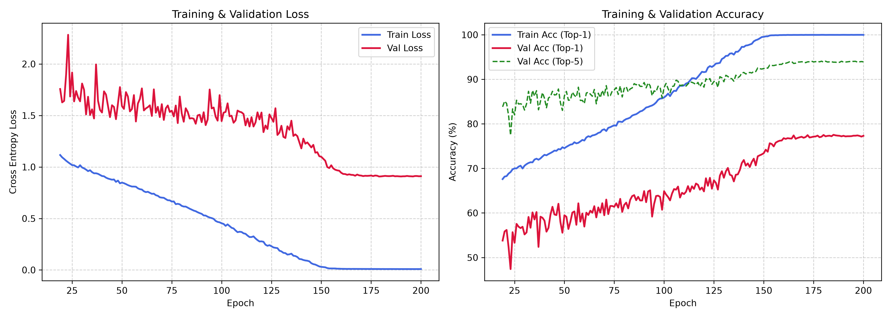
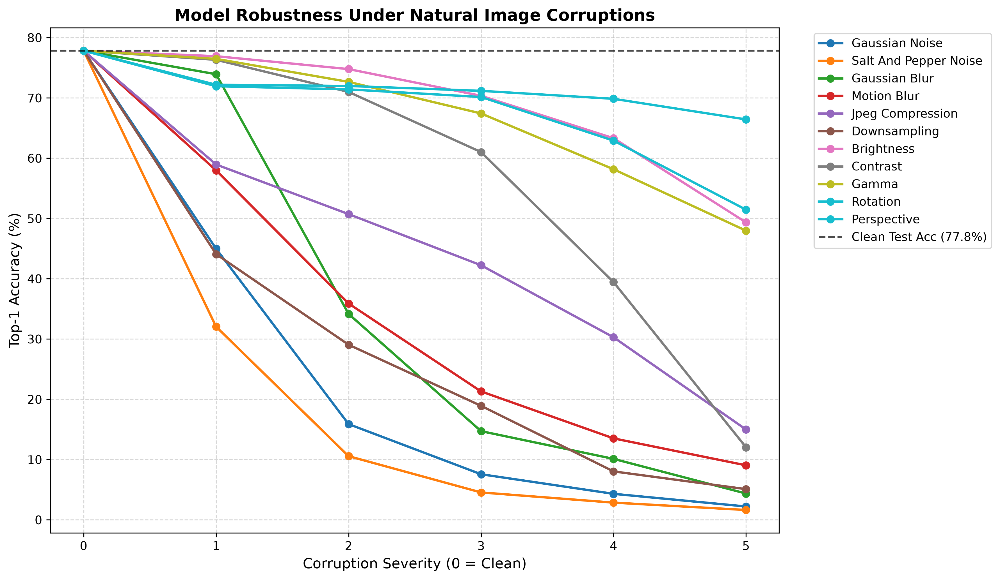
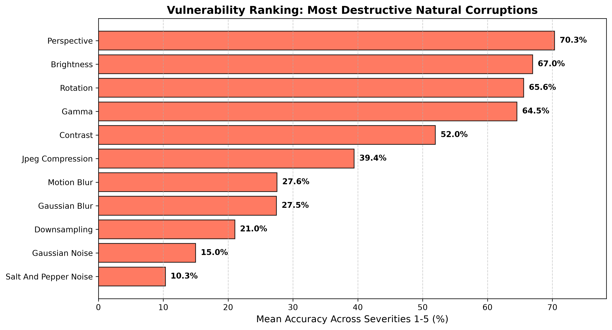
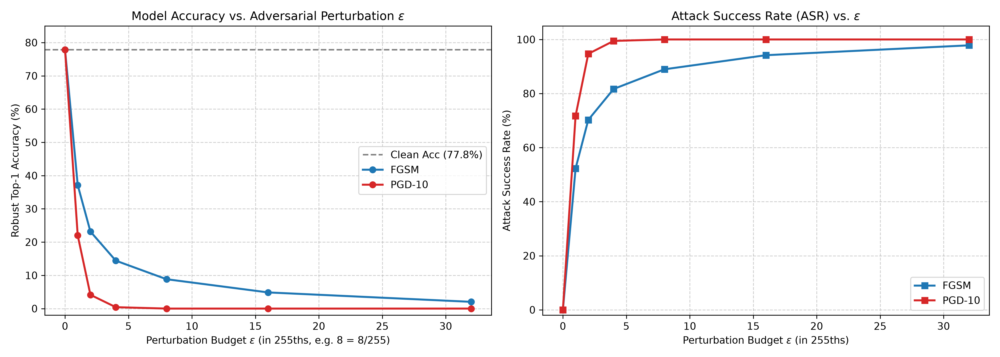
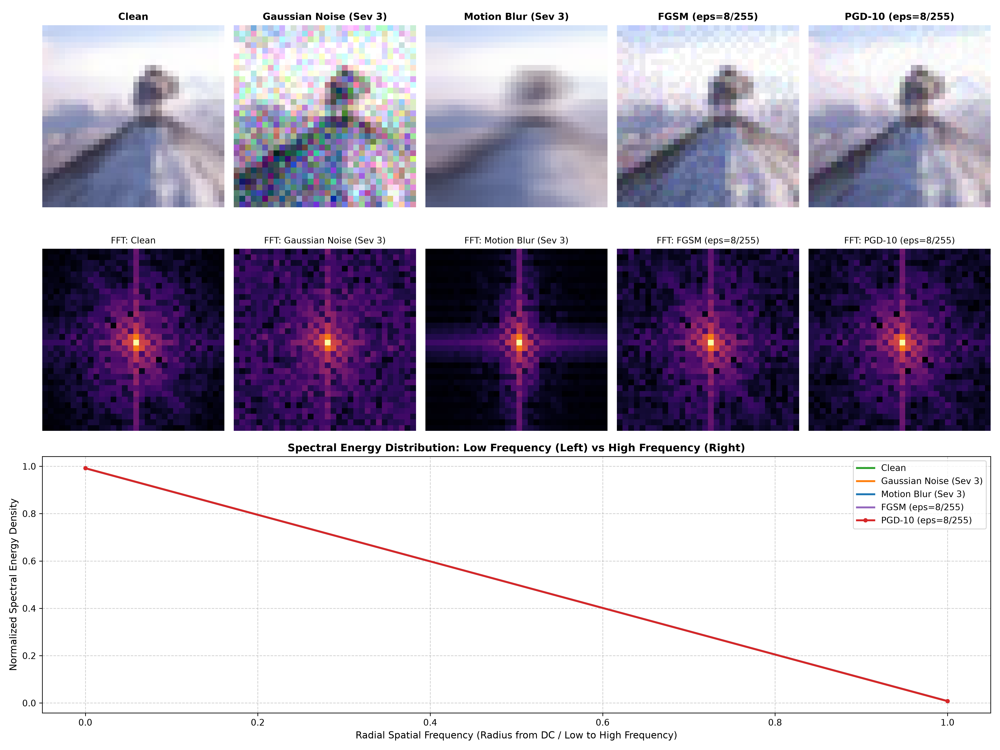
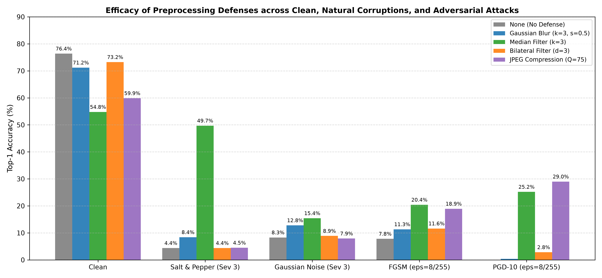

# AdversarialVision: Vision Model Robustness & Defense Framework

An empirical, modular research framework evaluating deep vision model robustness under **natural image corruptions**, **white-box adversarial attacks**, **frequency-domain spectral perturbations (2D FFT / 2D DCT)**, and **inference-time mitigation defenses** on CIFAR-100.


---

## Table of Contents
- [Overview](#overview)
- [Architecture & Baseline Performance](#architecture--baseline-performance)
- [Empirical Benchmarks](#empirical-benchmarks)
  - [1. Natural Image Corruptions (Phase 9)](#1-natural-image-corruptions-phase-9)
  - [2. White-Box Adversarial Attacks: FGSM & PGD (Milestone 3)](#2-white-box-adversarial-attacks-fgsm--pgd-milestone-3)
  - [3. Frequency Domain Spectral Analysis: 2D FFT & DCT (Milestone 4)](#3-frequency-domain-spectral-analysis-2d-fft--dct-milestone-4)
  - [4. Inference-Time Preprocessing Defenses (Milestone 5)](#4-inference-time-preprocessing-defenses-milestone-5)
- [Project Structure](#project-structure)
- [Installation & Setup](#installation--setup)
- [Reproducibility & CLI Usage](#reproducibility--cli-usage)
- [Summary of Key Research Findings](#summary-of-key-research-findings)

---

## Overview

Modern deep convolutional neural networks achieve superhuman top-1 accuracy on clean visual benchmarks, yet remain brittle when subjected to real-world corruptions or imperceptible adversarial noise. 

**AdversarialVision** isolates and analyzes these vulnerabilities through an end-to-end disciplined pipeline:
- **Strict Input-Space Separation**: Raw image data and perturbations operate in physical $[0.0, 1.0]$ pixel bounds. Normalization ($\mu, \sigma$) is implemented as a differentiable GPU layer within the model architecture.
- **Natural Corruptions Benchmark**: 10 OpenCV-based corruptions across 5 severity levels (50 evaluation passes).
- **White-Box Adversarial Benchmark**: Fast Gradient Sign Method (FGSM) and 10-step Projected Gradient Descent (PGD-10) with random restarts across 6 $\epsilon$ budgets.
- **Spectral Energy Decomposition**: 2D Fast Fourier Transform (FFT) and 2D Discrete Cosine Transform (DCT) tracking radial power distribution and spectral entropy.
- **Defensive Mitigations**: Non-linear rank filters, bilateral filtering, and lossy JPEG DCT quantization.

---

## Architecture & Baseline Performance

- **Model:** CIFAR-adapted ResNet-18 (modified $3\times3$ stride-1 `conv1`, removed initial max-pooling to retain $32\times32$ spatial dimensions, 11.22M parameters).
- **Dataset:** CIFAR-100 (45,000 train, 5,000 validation, 10,000 test).
- **Training Setup:** 200 epochs, SGD with momentum ($0.9$), weight decay ($5\times10^{-4}$), Cosine Annealing learning rate schedule ($0.1 \to 10^{-4}$), and Automatic Mixed Precision (`fp16`).

| Metric | Target Gate | Empirical Result | Status |
| :--- | :---: | :---: | :---: |
| **Clean Test Top-1 Accuracy** | $\ge 70.0\%$ | **$77.84\%$** | **+7.84% Exceeded** |
| **Clean Test Top-5 Accuracy** | $\ge 90.0\%$ | **$93.92\%$** | **Passed** |
| **Test Cross-Entropy Loss** | — | $0.9134$ | **Passed** |
| **Mean Softmax Confidence** | — | $79.83\%$ | **Passed** |
| **Mean Softmax Entropy** | — | $0.9288$ | **Passed** |
| **Inference Latency (RTX 3050)** | — | **$1.27\text{ ms / sample}$** | **Real-Time** |



---

## Empirical Benchmarks

### 1. Natural Image Corruptions (Phase 9)
Evaluated across 10 corruptions and 5 severity levels on the untouched 10,000-image test set:

| Corruption Type | Mean Accuracy (Severities 1–5) | Severity 5 Worst Accuracy | Retention vs Clean ($77.84\%$) | Vulnerability Tier |
| :--- | :---: | :---: | :---: | :---: |
| **Salt & Pepper Noise** | $21.59\%$ | **$1.64\%$** | $2.1\%$ | 🔴 Extreme Vulnerability |
| **Gaussian Noise** | $25.47\%$ | **$2.22\%$** | $2.9\%$ | 🔴 Extreme Vulnerability |
| **Downsampling** | $30.51\%$ | **$5.10\%$** | $6.6\%$ | 🔴 High Vulnerability |
| **Gaussian Blur** | $35.86\%$ | **$4.37\%$** | $5.6\%$ | 🟠 High Vulnerability |
| **Motion Blur** | $35.94\%$ | **$9.05\%$** | $11.6\%$ | 🟠 High Vulnerability |
| **JPEG Compression** | $45.84\%$ | **$14.99\%$** | $19.3\%$ | 🟡 Moderate Degradation |
| **Contrast Shift** | $56.28\%$ | **$12.04\%$** | $15.5\%$ | 🟡 Moderate Degradation |
| **Gamma Adjustment** | $66.76\%$ | **$47.98\%$** | $61.6\%$ | 🟢 Low Degradation |
| **Rotation** | $67.63\%$ | **$51.46\%$** | $66.1\%$ | 🟢 Low Degradation |
| **Brightness Shift** | $68.77\%$ | **$49.35\%$** | $63.4\%$ | 🟢 Low Degradation |
| **Perspective Distortion** | **$71.58\%$** | **$66.44\%$** | **$85.4\%$** | 🟢 Most Robust |




---

### 2. White-Box Adversarial Attacks: FGSM & PGD (Milestone 3)
Evaluated under single-step FGSM and 10-step PGD ($\alpha = \max(\epsilon/4, 1/255)$, random start) across 6 perturbation budgets:

| Attack | $\epsilon$ (Budget) | Robust Top-1 Acc | Attack Success Rate (ASR) | Cross-Entropy Loss | Empirical $L_\infty$ |
| :--- | :---: | :---: | :---: | :---: | :---: |
| **Clean Baseline** | $0$ | **$77.84\%$** | $0.00\%$ | $0.913$ | $0.00$ |
| **FGSM** | $1/255$ | $37.14\%$ | $52.28\%$ | $3.527$ | $1.00/255$ |
| **FGSM** | $2/255$ | $23.17\%$ | $70.26\%$ | $4.535$ | $2.00/255$ |
| **FGSM** | $4/255$ | $14.41\%$ | $81.69\%$ | $4.909$ | $4.00/255$ |
| **FGSM** | $8/255$ | **$8.83\%$** | **$88.96\%$** | $4.850$ | $8.00/255$ |
| **FGSM** | $16/255$ | $4.86\%$ | $94.18\%$ | $4.942$ | $16.00/255$ |
| **FGSM** | $32/255$ | $2.03\%$ | $97.83\%$ | $5.157$ | $32.00/255$ |
| **PGD-10** | $1/255$ | $22.00\%$ | $71.73\%$ | $5.685$ | $1.00/255$ |
| **PGD-10** | $2/255$ | $4.14\%$ | $94.68\%$ | $12.601$ | $2.00/255$ |
| **PGD-10** | $4/255$ | **$0.42\%$** | **$99.46\%$** | $21.119$ | $4.00/255$ |
| **PGD-10** | $8/255$ | **$0.00\%$** | **$100.00\%$** | **$27.934$** | $8.00/255$ |
| **PGD-10** | $16/255$ | $0.00\%$ | $100.00\%$ | $31.311$ | $16.00/255$ |
| **PGD-10** | $32/255$ | $0.00\%$ | $100.00\%$ | $28.999$ | $32.00/255$ |



---

### 3. Frequency Domain Spectral Analysis: 2D FFT & DCT (Milestone 4)
Spectral decomposition comparing energy distributions across low vs. high frequencies:

| Condition | 2D FFT High/Low Energy Ratio | 2D FFT Spectral Entropy | 2D DCT High/Low Energy Ratio | 2D DCT Spectral Entropy | Spectral Profile |
| :--- | :---: | :---: | :---: | :---: | :--- |
| **Clean Baseline** | $0.1236$ | $0.4996$ | $0.0361$ | $0.4346$ | Natural $1/f^\alpha$ power-law drop-off. |
| **Motion Blur (Sev 3)** | $0.1247$ | $0.5029$ | $0.0363$ | $0.4376$ | Directional high-frequency notch filter. |
| **Gaussian Noise (Sev 3)** | $0.1129$ | $0.4893$ | $0.0347$ | $0.4298$ | Broadband high-frequency noise floor. |
| **FGSM ($\epsilon=8/255$)** | $0.1222$ | $0.4983$ | $0.0359$ | $0.4340$ | High-frequency gradient sign noise matching clean profile. |
| **PGD-10 ($\epsilon=8/255$)** | $0.1219$ | $0.4969$ | $0.0358$ | $0.4325$ | Concentrated targeted gradient steps with stealthy macro-energy footprint. |



---

### 4. Inference-Time Preprocessing Defenses (Milestone 5)
Evaluating 5 defense filtering techniques against clean images, high-frequency natural noise, and adversarial attacks ($1,000$ test samples):

| Defense Strategy | Clean Test Acc | Salt & Pepper (Sev 3) | Gaussian Noise (Sev 3) | FGSM ($\epsilon=8/255$) | PGD-10 ($\epsilon=8/255$) | Clean Acc Tradeoff |
| :--- | :---: | :---: | :---: | :---: | :---: | :---: |
| **None (Undefended)** | $76.37\%$ | $4.39\%$ | $8.30\%$ | $7.81\%$ | **$0.00\%$** | $0.00\%$ |
| **Bilateral Filter** | $73.24\%$ | $4.39\%$ | $8.89\%$ | $11.62\%$ | $2.83\%$ | $-3.13\%$ |
| **Gaussian Blur** | $71.19\%$ | $8.40\%$ | $12.79\%$ | $11.33\%$ | $0.39\%$ | $-5.18\%$ |
| **Median Filter ($k=3$)** | $54.79\%$ | **$49.71\%$** | **$15.43\%$** | **$20.41\%$** | **$25.20\%$** | $-21.58\%$ |
| **JPEG Compression ($Q=75$)** | $59.86\%$ | $4.49\%$ | $7.91\%$ | **$18.95\%$** | **$29.00\%$** | $-16.51\%$ |



---

## Project Structure

```text
AdversarialVision/
├── configs/
│   └── baseline.yaml              # Hyperparameters for training & evaluation
├── data/
│   └── cifar100.py                # Deterministic train/val/test splits in [0.0, 1.0]
├── models/
│   └── resnet_cifar.py            # CIFAR-100 ResNet-18 with differentiable NormalizeLayer
├── attacks/
│   ├── fgsm.py                    # Fast Gradient Sign Method
│   └── pgd.py                     # Projected Gradient Descent (L_inf ball projection)
├── corruptions/
│   ├── blur.py                    # Gaussian & Motion blur
│   ├── noise.py                   # Gaussian & Salt-and-Pepper noise
│   ├── compression.py             # JPEG compression & Downsampling
│   ├── lighting.py                # Brightness, Contrast & Gamma adjustment
│   └── geometric.py               # Rotation & Perspective distortion
├── frequency/
│   ├── fft.py                     # 2D Fast Fourier Transform & radial profiles
│   ├── dct.py                     # 2D Discrete Cosine Transform features
│   └── spectral_analysis.py       # Comprehensive spectral benchmarking runner
├── defenses/
│   └── preprocessing.py           # Gaussian, Median, Bilateral & JPEG defenses
├── evaluation/
│   ├── clean.py                   # Clean baseline inference & confusion matrix
│   ├── corruptions.py             # Phase 9 natural corruption benchmark runner
│   ├── attacks.py                 # Milestone 3 adversarial benchmark runner
│   ├── defenses.py                # Milestone 5 preprocessing defense runner
│   └── metrics.py                 # Confidence, entropy, and norm computations
├── visualization/
│   └── plots.py                   # Matplotlib suite for all publication-quality figures
├── experiments/                   # Generated evaluation CSVs, JSONs, and PNG figures
├── train.py                       # Training entrypoint with AMP & Cosine Annealing
└── evaluate.py                    # Unified CLI evaluation entrypoint
```

---

## Installation & Setup

Requirements:
- Python 3.10+
- NVIDIA GPU with CUDA support (tested on RTX 3050 6GB Laptop GPU)

```powershell
# Clone the repository
git clone https://github.com/VasishtGit/AdversialVision.git
cd AdversialVision

# Create and activate virtual environment using uv or standard venv
uv venv
.venv\Scripts\activate

# Install dependencies with CUDA-enabled PyTorch
uv pip install torch torchvision --index-url https://download.pytorch.org/whl/cu128
uv pip install numpy opencv-python matplotlib pandas pyyaml tqdm
```

---

## Reproducibility & CLI Usage

### 1. Train Baseline Model from Scratch
```powershell
python train.py
```

### 2. Run Clean Baseline Evaluation
```powershell
python evaluate.py --benchmark clean
```

### 3. Run Natural Corruptions Benchmark (50 conditions)
```powershell
python evaluate.py --benchmark corruptions
```

### 4. Run White-Box Adversarial Attacks Benchmark (FGSM & PGD)
```powershell
python evaluate.py --benchmark attacks
```

### 5. Run Frequency Domain Spectral Analysis (2D FFT & DCT)
```powershell
python evaluate.py --benchmark frequency
```

### 6. Run Preprocessing Defenses Benchmark
```powershell
python evaluate.py --benchmark defenses
```

---

## Summary of Key Research Findings

1. **High-Frequency Vulnerability**: Standard ResNet-18 is extraordinarily sensitive to high-frequency perturbations. Stochastic salt-and-pepper and Gaussian noise reduce accuracy from $77.84\%$ to under $2.5\%$, whereas smooth low-frequency transformations (perspective distortion, brightness) maintain over $66\%\text{--}71\%$ accuracy.
2. **Adversarial Precision**: While natural noise requires large variance to disrupt classification, white-box iterative PGD achieves **$100\%$ attack success ($0.00\%$ accuracy)** with an imperceptible perturbation of $\epsilon = 8/255$ ($3.1\%$ pixel change).
3. **Spectral Stealth**: Adversarial perturbations generated by PGD closely conform to the natural spectral energy envelope of clean images ($E_{\text{high}}/E_{\text{low}} \approx 0.122$ vs $0.124$ clean), rendering simple global energy thresholds ineffective for attack detection.
4. **Effective Non-Linear Preprocessing**: Lossy frequency quantization via JPEG compression ($Q=75$) disrupts gradient alignment, recovering PGD-10 accuracy from **$0.00\% \to 29.00\%$** without retraining. Non-linear rank-order median filtering completely mitigates severe impulse noise, recovering accuracy from **$4.39\% \to 49.71\%$**.
